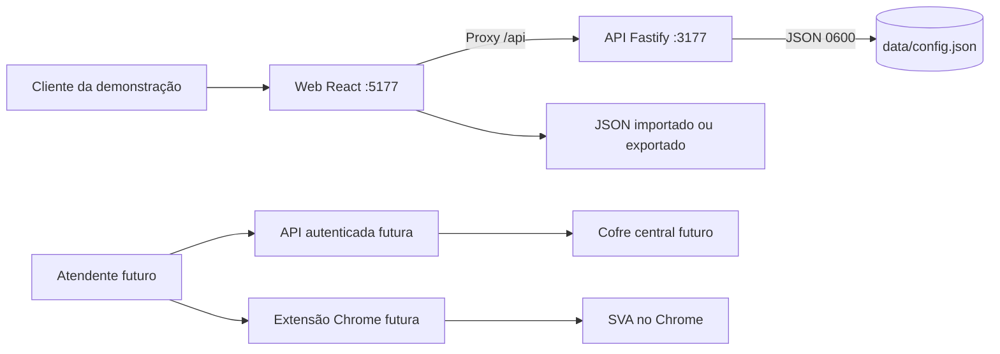

# Arquitetura

## Demonstração atual (R1 entregue)

A configuração é validada tanto no frontend (`apps/web/src/config.ts`) quanto no backend (`apps/api/src/server.ts`). A web consome a API Fastify local em `127.0.0.1:3177` via proxy reverso no Vite. A API persiste os dados no arquivo local `data/config.json` de forma atômica (arquivo temporário seguido de rename, com modo de criação `0600`). Cada link é HTTPS, abre em nova aba e suporta logo opcional individual em base64 (< 500 KB). A logo da empresa suporta PNG/JPG/WebP (< 1 MB). O salvamento é explícito e requer confirmação na interface ("Salvar alterações"). Se a API estiver offline, a web bloqueia edição e exibe banner informativo. O JSON exportado pode ser importado para transferir configurações entre instalações.

`/health` e `/api/config` não contêm segredos ou dados de negócio sensíveis. A extensão não se conecta à web e não tem permissões de host. A interface é uma casca reutilizável instalada isoladamente por cliente (single-tenant local).

## Fronteiras da futura variante privada

- A web apresentará catálogo somente após sessão válida e autorização da API; nunca receberá senha de SVA.
- A API conferirá usuário, papel, serviço e dono da credencial em cada operação sensível. O bilhete de abertura será curto e de uso único; contrato, armazenamento e expiração ainda estão pendentes.
- A extensão aceitará mensagens apenas da origem oficial, abrirá destinos permitidos e trocará o bilhete pela credencial específica somente no formulário reconhecido. Não persistirá senhas em texto claro.
- Sessões e desafios dos fornecedores pertencem aos próprios sites. O Hub não lê cookies de outra origem nem contorna CAPTCHA/2FA.
- Planilhas de consulta da variante privada manterão permissões no Google Sheets, independentes do login no Hub.

npm workspaces mantêm um lockfile. Vite serve a web, Fastify fornece a API TypeScript e esbuild empacota a extensão Manifest V3. Banco, criptografia e autenticação aguardam desenho de segurança.
