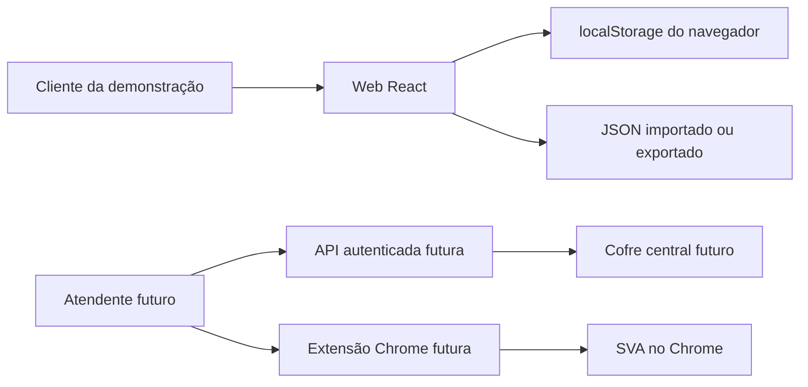

# Arquitetura

## Demonstração atual

A configuração é validada em `apps/web/src/config.ts`. A web usa somente estado React e `localStorage`; não chama a API. Cada link é HTTPS, abre em nova aba e não recebe credenciais. A logo é um data URL de PNG/JPG/WebP com limite de tamanho. O JSON exportado pode conter esses dados, portanto deve ser revisado antes de compartilhamento. O catálogo de exemplo é público por definição e não contém destinos do DRS.

`/health` não contém dados de negócio. A extensão não se conecta à web e não tem permissões de host. A interface é uma casca reutilizável e uma demonstração de portfólio; configuração local não é administração multiusuário.

## Fronteiras da futura variante privada

- A web apresentará catálogo somente após sessão válida e autorização da API; nunca receberá senha de SVA.
- A API conferirá usuário, papel, serviço e dono da credencial em cada operação sensível. O bilhete de abertura será curto e de uso único; contrato, armazenamento e expiração ainda estão pendentes.
- A extensão aceitará mensagens apenas da origem oficial, abrirá destinos permitidos e trocará o bilhete pela credencial específica somente no formulário reconhecido. Não persistirá senhas em texto claro.
- Sessões e desafios dos fornecedores pertencem aos próprios sites. O Hub não lê cookies de outra origem nem contorna CAPTCHA/2FA.
- Planilhas de consulta da variante privada manterão permissões no Google Sheets, independentes do login no Hub.

npm workspaces mantêm um lockfile. Vite serve a web, Fastify fornece a API TypeScript e esbuild empacota a extensão Manifest V3. Banco, criptografia e autenticação aguardam desenho de segurança.
