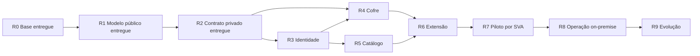

# Roadmap do Hublink

**Atualizado em:** 15/10/2026

**Estado:** plano de execução para retomada; etapas futuras ainda não equivalem a autorização de implantação ou acesso a fornecedores.

**Fontes:** estado do repositório, `README.md`, `docs/CONTEXT.md`, `docs/DECISIONS.md`, `docs/OPEN_QUESTIONS.md` e DRS v0.37 preservado no diretório de pesquisa, fora deste repositório público.

## 1. Como ler

- **Entregue:** existe no código e tem prova local proporcional. Não implica publicação do aplicativo ou comportamento real em fornecedor.
- **Próximo:** trabalho concreto que pode ser planejado sem assumir decisões de segurança ainda abertas.
- **Pendente de decisão:** precisa de escolha de produto, arquitetura ou operação antes de codificar a parte afetada.
- **Planejado:** sequência proposta; escopo e critérios devem ser confirmados ao iniciar a etapa.
- **Piloto:** depende de ambiente, pessoas e fornecedores reais. Teste sintético não substitui essa prova.

O Hublink tem dois percursos relacionados. O **modelo público reutilizável** permite demonstrar marca e links públicos. A **variante privada de SVAs** requer login, API autorizada, cofre central e extensão. A configuração na API local da demonstração não é a base de segurança da variante privada.

## 2. Estado de partida

### Entregue no repositório

- Monorepo npm com web React/TypeScript, API Fastify/TypeScript e extensão Chrome Manifest V3.
- Demonstração com nome, descrição, logo PNG/JPG/WebP, cor RGB, cards de links HTTPS públicos, edição e remoção.
- Configuração validada, importação/exportação JSON e persistência por API local (`GET/PUT /api/config`) em arquivo privado com escrita atômica. Edição em rascunho e salvamento explícito.
- Logos opcionais por card, estado de API indisponível, foco no painel e retorno por `Escape`.
- API em loopback; extensão sem permissões de host, sem troca de mensagens e sem automação.
- PostgreSQL 16 isolado, DDL nativo de seis tabelas e contrato privado em `docs/PRIVATE_SPEC.md`; R3 usa o banco para identidade, sessões e administração básica.
- Verificações locais: `npm run check` executa tipos, lint, formatação, testes e builds; `npm run test:e2e` cobre cinco cenários reais em Chromium headless com dados sintéticos isolados. O repositório já está no GitHub, mas o aplicativo não foi publicado.
- README em inglês; regras para agentes em `AGENTS.md`. O DRS bruto, com links operacionais, continua fora do repositório público.

### Ainda não entregue

- Revisão manual ampliada em navegadores e dispositivos reais, incluindo importação manual, marcas variadas e conteúdo extremo. O E2E local não substitui essa prova.
- Autorização para edição da configuração pública, fluxo operacional de publicação, versões, rollback e backup.
- 2FA do admin, limitação de tentativas, cofre, catálogo privado e auditoria das operações futuras.
- Protocolo web–extensão–API, permissões por fornecedor, adaptadores e piloto autenticado.
- CI, implantação on-premise, DNS/TLS, backup/restauração operacional e distribuição da extensão.

## 3. Sequência de entregas

### R0 — Base pública e repositório — ENTREGUE

**Resultado:** casca configurável para portfólio e estrutura técnica separada para web, API e extensão.

**Limite da prova:** o build e os testes locais não demonstram visual final em Chrome, persistência entre usuários, login ou compatibilidade com SVA. O JSON exportado pode conter dados inseridos pelo usuário e precisa de revisão antes de compartilhamento.

**Dependência seguinte:** R1 pode avançar na experiência pública; R2 deve fechar decisões antes de qualquer rota sensível da variante privada.

### R1 — Qualidade e produto reutilizável — ENTREGUE

**Objetivo:** tornar a demonstração uma referência confiável para apresentar e configurar clientes, sem misturar dados privados com o portfólio.

**Entregas:** API local `GET/PUT /api/config` com validação e escrita atômica, rascunho com salvamento explícito, logos opcionais nos cards, bloqueio de edição sem API e acessibilidade de foco/`Escape`. A suíte Playwright cobre carregamento, edição e persistência após reload, logo, teclado, layout desktop/mobile sem overflow e exportação JSON. O modelo decidido é uma instalação isolada por cliente, registrado em `docs/DECISIONS.md`.

**Limite da prova:** Chromium headless e dados sintéticos demonstram o fluxo local. A revisão manual ampliada, infraestrutura, backup, publicação do app e comportamento de fornecedor continuam fora desse aceite. Links e logos de clientes só entram em ambiente apropriado e com direito de uso.

### R2 — Fechar o contrato da variante privada — ENTREGUE

**Objetivo:** transformar as escolhas do DRS em contratos implementáveis antes do login, cofre e extensão.

**Entregas:** PostgreSQL 16 em Compose, limitado a `127.0.0.1` e porta 5439 por padrão; DDL de usuários, sessões, serviços, credenciais, bilhetes e auditoria; contrato de sessão rolling de 365 dias, cofre AES-256-GCM, bilhete único de 30 segundos e catálogo privado do piloto. `docs/PRIVATE_SPEC.md` descreve fluxos, ameaças, limites e aceite futuro. `docs/OPEN_QUESTIONS.md` distingue escolhas locais das decisões operacionais adiadas.

**Limite:** R2 entrega desenho e schema, sem endpoints sensíveis nem prova de fornecedor. O piloto local adia 2FA do Hub; exposição remota requer origem/TLS, 2FA administrativo, custódia de chave, backup/restauração e associação segura da extensão. Cada URL e adaptador exigem validação própria.

### R3 — Identidade, sessões e administração — ENTREGUE LOCALMENTE

**Trabalho previsto:**

- Criar contas com usuário de exibição, e-mail único e senha inicial definida pelo admin; login por e-mail e senha, sem convite ou e-mail automático na V1.
- Guardar apenas hash apropriado da senha do Hub. Definir tentativa de login, erros, auditoria e limites de abuso conforme o desenho aprovado.
- Configurar pool do PostgreSQL (`pg`) com limites explícitos (`max: 10`, `idleTimeoutMillis: 30000`) e encerramento limpo via hook `server.addHook('onClose', ...)` para prevenir vazamento de conexões.
- Implementar papéis de admin e atendente, sessão protegida, “manter conectado”, Sair e revogação por usuário/dispositivo.
- Restringir administração do piloto à rede local/loopback. Definir e implementar 2FA do Hub antes de exposição remota ou produção, conforme gate de R2.
- Permitir redefinição assistida pelo admin após conferência operacional; redefinição invalida todas as sessões anteriores do atendente.

**Aceite:** acesso a rota privada sem sessão é negado no servidor; papel e identidade são conferidos por operação; revogação e redefinição impedem novo acesso imediatamente, inclusive em sessão persistente. Conexões de banco encerram limpamente sem vazamento. Logs não contêm senha, cookie ou código 2FA.

**Entrega R3:** login, logout, sessão rolling em PostgreSQL, criação de atendente e redefinição com revogação transacional. A web bloqueia os links antes do login. Os endpoints `GET/PUT /api/config` permanecem da demonstração pública local e não constituem catálogo privado. O piloto local ainda não implementa 2FA do Hub, limitação de tentativas ou confirmação operacional antes de redefinir senha. R3 não autoriza exposição remota ou produção.

### R4 — Cofre central e auditoria — PRÓXIMO; DEPENDE DE R2 E R3

**Trabalho previsto:**

- Cifrar credenciais de SVA de modo reversível com chave protegida separadamente dos dados; versionar e rotacionar o esquema conforme decisão de R2.
- Validar rigorosamente a chave mestra `VAULT_MASTER_KEY` no boot da API (recusar inicialização fail-closed se a chave não tiver exatamente 32 bytes / 256 bits ou formato inválido).
- Vincular credencial individual ao atendente e credencial compartilhada ao serviço/equipe; não entregar o cofre inteiro ao cliente.
- Admin cadastra e atualiza as compartilhadas; atendente cadastra e atualiza somente as próprias individuais.
- Admin pode revelar individuais e compartilhadas para suporte; atendente revela apenas as próprias individuais. Compartilhadas ficam ocultas ao atendente no Hub.
- Registrar criação, alteração, revelação, revogação e falhas sem registrar valores secretos. Preparar backup e prova de restauração.

**Aceite:** testes de autorização cruzada, isolamento por dono, rotação, falha de chave e restauração. Inicialização recusa chave inválida no boot. O controle de interface precisa corresponder à decisão da API. Não prometer sigilo absoluto depois que uma senha é preenchida no Chrome do usuário.

### R5 — Catálogo privado e jornadas do Hub — PLANEJADO; DEPENDE DE R3

**Trabalho previsto:**

- Servir cards e destinos autorizados pela API autenticada; todos os atendentes veem os mesmos cards no piloto, mantendo credenciais individuais isoladas.
- Mostrar Fullarm e CRM como cards normais sem ação até que tenham URL validada. Definir como o admin libera URL, estado ativo/inativo e mudanças de domínio.
- Abrir as três planilhas de consulta em nova aba sem solicitar credenciais do cofre. A permissão real continua no Google Sheets.
- Diferenciar extensão ausente, destino indisponível, sessão do Hub inválida e erro de abertura. Manter link/manual fallback quando apropriado.

**Aceite:** nenhum catálogo privado aparece sem sessão; nenhuma URL de SVA ou planilha privada é embutida na demonstração pública; card sem URL não abre aba; o Hub não declara autenticação no fornecedor apenas porque abriu o destino.

### R6 — Protocolo da extensão Chrome — PLANEJADO; DEPENDE DE R2, R3, R4 E R5

**Trabalho previsto:**

- Fixar origem oficial e ID estável da extensão; validar cabeçalho `Origin` oficial nas rotas mutativas (`POST`, `PUT`, `DELETE`).
- Emitir e consumir bilhete limitado à tentativa; a extensão solicita apenas a credencial autorizada para o formulário reconhecido.
- Adicionar rotina periódica de limpeza de bilhetes expirados (`opening_tickets`), expurgando registros antigos com mais de 24h.
- Adicionar permissões por domínio aprovado, sem `*://*/*`, código remoto ou persistência de senha em texto claro.
- Tratar suspensão do service worker, repetição de mensagem, timeout e atualização da extensão sem reutilizar bilhete gasto.

**Aceite:** testes de origem falsa, serviço trocado, replay, expiração, revogação durante a tentativa e indisponibilidade. Nenhuma senha passa pelo React, por URL ou por log.

### R7 — Adaptadores e piloto por fornecedor — PILOTO; DEPENDE DE R6

**Sequência proposta, sujeita à validação por fornecedor:** PARTIU! para conta compartilhada sem desafio visível; Fullcam para conta individual; Playhub para formulário com reCAPTCHA e 2FA humanos. IPTV integra o catálogo, mas seu adaptador depende de validação de Turnstile. CRM e Fullarm permanecem sem ação até validação de URL.

**Critérios por serviço:**

1. Clique abre o destino correto e sessão válida chega ao dashboard sem novo login.
2. Formulário conhecido recebe somente a credencial do serviço e, se permitido, é enviado uma vez. Tela inesperada para a automação.
3. CAPTCHA, Turnstile quando exigir ação e 2FA permanecem com o atendente; não contornar desafios.
4. Falha de senha, desafio, timeout, extensão ausente e mudança de formulário produzem estados distintos, sem falsa confirmação.
5. Login manual continua possível. Resultado real é registrado por serviço, data, versão de extensão e condição observada, sem segredo ou dado de cliente.

**Aceite:** prova sintética para regressão e piloto autorizado em Chrome com conta adequada; não inferir compatibilidade de produção apenas da existência de campos de login na página pública.

### R8 — Operação on-premise e implantação — PLANEJADO; DEPENDE DE R2–R7

**Trabalho previsto:** confirmar capacidade do servidor, DNS, certificado TLS, proxy, armazenamento, chave, rotina de backup/restauração, monitoramento, atualização e rollback. Distribuir extensão Chrome manualmente sob controle do admin/dev no piloto, com ID estável e permissões revisadas. Definir procedimento de desligamento que inclui sessões e senhas nos próprios fornecedores.

**Aceite:** implantação reproduzível e recuperação ensaiada; domínio/origem conferidos no Chrome; revogação e indisponibilidade testadas; evidências do piloto distinguem API, extensão, fornecedor e ambiente. Publicação de portfólio e implantação privada têm destinos e provas separados.

### R9 — Fechamento do piloto e evolução — APÓS R8

Consolidar métricas acordadas em R2, falhas por serviço, tempo e intervenção humana necessários, incidentes e custo de manter adaptadores. Decidir expansão para os demais SVAs, Edge, distribuição gerenciada da extensão e modelo comercial de reutilização. Cada expansão exige contrato e validação específicos; não transformar um piloto aprovado em promessa universal de SSO.

## 4. Dependências e caminhos paralelos

R1 foi validado localmente sem credenciais reais. R3–R6 só devem assumir as decisões fechadas em R2. Projeto público no GitHub não equivale a app publicado; Chromium local não equivale a piloto ou produção.

## 5. Ponto de retomada da próxima sessão

1. Ler `AGENTS.md`, este roadmap, `docs/CONTEXT.md`, `docs/DECISIONS.md` e `docs/OPEN_QUESTIONS.md`; verificar `git status --short --branch`. Preservar alterações e runtime locais de outras ferramentas.
2. Retomar em **R4** com `docs/PRIVATE_SPEC.md`: implementar cofre central e auditoria por operação com testes sintéticos, após fechar formato de chave e backup.
3. Antes de rotas de cofre ou extensão, fechar formato cifrado, custódia/rotação/backup da chave, origem oficial e associação da extensão. Uma revisão manual ampliada da demonstração pode seguir em paralelo.
4. Para qualquer feature, atualizar o README em inglês no mesmo trabalho. Registrar prova local, lacunas de navegador/fornecedor e próximo passo. Commits, quando solicitados, têm mensagem em inglês.

**Pendência documental conhecida:** `docs/CONTEXT.md` era anterior ao primeiro commit; esta rodada o sincroniza com o estado publicado. O DRS v0.37 continua rascunho e não foi copiado para o repositório público.
